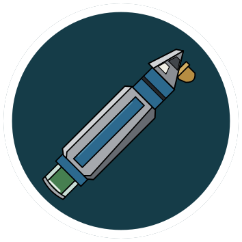
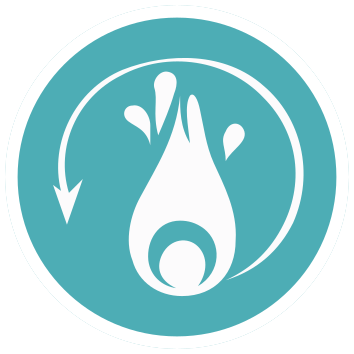
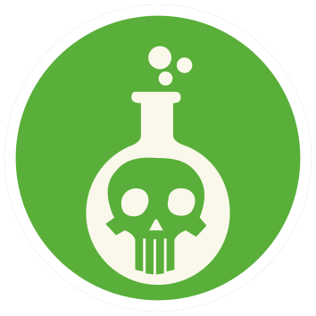
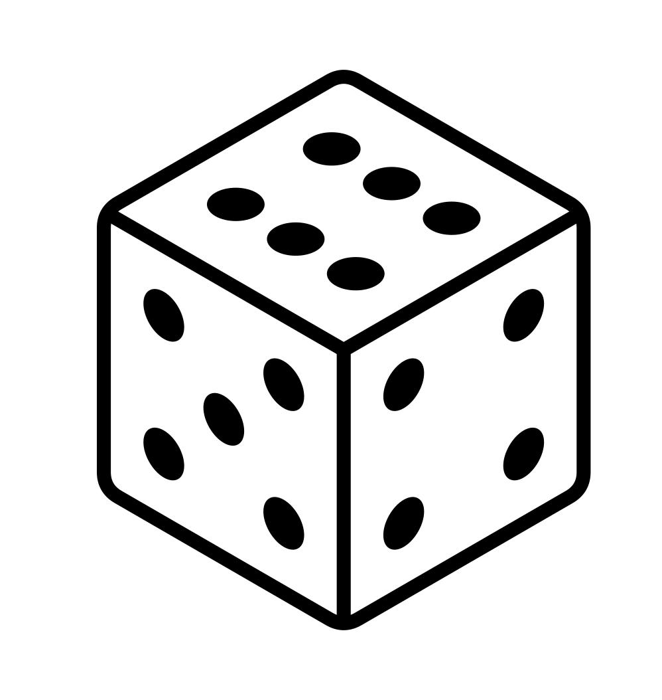

# EMH — Rules

## Dice

| Die result | Symbol |
| --- | --- |
| 1–3 | Caduceus |
| 4–5 | Music |
| 6 | Photon |

## HERO BOARD

### Photonic Blast

  
 Deal <b>4</b>

  
 Deal <b>5</b>

  
 Deal <b>6</b>

### Aria

  

  
Gain <b>2</b>  and <b>1</b> 

  
Draw <b>1</b>

### Dermal Regeneration

  

  
A chosen player will draw <b>1</b>, heal <b>4</b>, and gain <b>1</b>  or <b>1</b> 

### Neuralytic Pathogen

  

  
Deal <b>5</b>

  
Inflict .

### Photonic Cannon (Large Straight)

  
Deal <b>9</b> then roll <b>1</b> . On a  make the attack undefendable

### Decompile (Small Straight)

  
Deal <b>7</b>

### Triage (Defense)

Rules text has not been written yet.

### Photons Be Free (Mini-Ultimate)

  
Deal <b>8</b>, gain , , and inflict .

### Emergency Command Hologram (Ultimate)

Rules text has not been written yet.

## LEAFLET

  
HYPOSPRAY

  
Positive Status Effect

  
Stack limit: 3

  
Spend this token to heal you or a teammate for <b>2</b>. When you gain a Hypospray, you may choose a teammate to gain it instead of you.

  
CLEANSE

  
Positive Status Effect

  
Stack limit: 3

  
Spend to remove a status effect token: A player with this token may spend it at any time to remove a single status effect token from themselves.

  
POISON

  
Negative Status Effect

  
Stack limit: 3

  
Receive 1 dmg per Poison token during your Upkeep Phase. Persistent.

Source for Poison: [Dice Throne Wiki](https://dice-throne.fandom.com/wiki/Poison) (CC BY-SA); wording condensed.

<!-- stdt-icon-inventory:v1
{
  "schema_version": 1,
  "status": "current",
  "source": "rules.md",
  "content_sha256": "aefe79f3dc06cfcafe402854ad768b884d26fbdaa1ac59a3810976ccb024a832",
  "counting": {
    "scope": "explicit gameplay icon references in rendered rules blocks",
    "excludes": [
      "CP cost/timing metadata",
      "titles",
      "design notes and brainstorming",
      "shared Standard Cards",
      "artwork-only icons"
    ],
    "number": "explicit data-value, or null for an unnumbered reference; excludes intrinsic die labels",
    "references": "occurrences, not quantities of tokens gained, dice rolled, or damage dealt",
    "asset_observations": "separate saved-artwork instances; never added to rules reference totals"
  },
  "coverage": {
    "leaflet": {
      "entries": 3,
      "references": 1
    },
    "hero_board": {
      "entries": 7,
      "references": 45
    },
    "cards": {
      "entries": 0,
      "references": 0
    }
  },
  "total_rules_references": 46,
  "entries": [
    {
      "section": "hero_board",
      "name": "Photonic Blast",
      "status": "written",
      "icons": [
        {
          "file": "caduceus_die.svg",
          "path": "icons/caduceus_die.svg",
          "number": null,
          "references": 12
        },
        {
          "file": "normal_damage.svg",
          "path": "../../Shared/icons/normal_damage.svg",
          "number": 4,
          "references": 1
        },
        {
          "file": "normal_damage.svg",
          "path": "../../Shared/icons/normal_damage.svg",
          "number": 5,
          "references": 1
        },
        {
          "file": "normal_damage.svg",
          "path": "../../Shared/icons/normal_damage.svg",
          "number": 6,
          "references": 1
        }
      ]
    },
    {
      "section": "hero_board",
      "name": "Aria",
      "status": "written",
      "icons": [
        {
          "file": "carddraw.svg",
          "path": "../../Shared/icons/carddraw.svg",
          "number": 1,
          "references": 1
        },
        {
          "file": "cleanse.svg",
          "path": "icons/cleanse.svg",
          "number": 1,
          "references": 1
        },
        {
          "file": "hypospray.svg",
          "path": "icons/hypospray.svg",
          "number": 2,
          "references": 1
        },
        {
          "file": "music_note_die.svg",
          "path": "icons/music_note_die.svg",
          "number": null,
          "references": 3
        }
      ]
    },
    {
      "section": "hero_board",
      "name": "Dermal Regeneration",
      "status": "written",
      "icons": [
        {
          "file": "caduceus_die.svg",
          "path": "icons/caduceus_die.svg",
          "number": null,
          "references": 3
        },
        {
          "file": "carddraw.svg",
          "path": "../../Shared/icons/carddraw.svg",
          "number": 1,
          "references": 1
        },
        {
          "file": "cleanse.svg",
          "path": "icons/cleanse.svg",
          "number": 1,
          "references": 1
        },
        {
          "file": "healing.svg",
          "path": "../../Shared/icons/healing.svg",
          "number": 4,
          "references": 1
        },
        {
          "file": "hypospray.svg",
          "path": "icons/hypospray.svg",
          "number": 1,
          "references": 1
        },
        {
          "file": "photon_die.svg",
          "path": "icons/photon_die.svg",
          "number": null,
          "references": 2
        }
      ]
    },
    {
      "section": "hero_board",
      "name": "Neuralytic Pathogen",
      "status": "written",
      "icons": [
        {
          "file": "caduceus_die.svg",
          "path": "icons/caduceus_die.svg",
          "number": null,
          "references": 2
        },
        {
          "file": "music_note_die.svg",
          "path": "icons/music_note_die.svg",
          "number": null,
          "references": 2
        },
        {
          "file": "normal_damage.svg",
          "path": "../../Shared/icons/normal_damage.svg",
          "number": 5,
          "references": 1
        },
        {
          "file": "photon_die.svg",
          "path": "icons/photon_die.svg",
          "number": null,
          "references": 1
        },
        {
          "file": "poison.svg",
          "path": "icons/poison.svg",
          "number": null,
          "references": 1
        }
      ]
    },
    {
      "section": "hero_board",
      "name": "Photonic Cannon",
      "status": "written",
      "icons": [
        {
          "file": "normal_damage.svg",
          "path": "../../Shared/icons/normal_damage.svg",
          "number": 9,
          "references": 1
        },
        {
          "file": "photon_die.svg",
          "path": "icons/photon_die.svg",
          "number": null,
          "references": 1
        },
        {
          "file": "roll_die.svg",
          "path": "../../Shared/icons/roll_die.svg",
          "number": 1,
          "references": 1
        }
      ]
    },
    {
      "section": "hero_board",
      "name": "Decompile",
      "status": "written",
      "icons": [
        {
          "file": "normal_damage.svg",
          "path": "../../Shared/icons/normal_damage.svg",
          "number": 7,
          "references": 1
        }
      ]
    },
    {
      "section": "hero_board",
      "name": "Photons Be Free",
      "status": "written",
      "icons": [
        {
          "file": "cleanse.svg",
          "path": "icons/cleanse.svg",
          "number": null,
          "references": 1
        },
        {
          "file": "hypospray.svg",
          "path": "icons/hypospray.svg",
          "number": null,
          "references": 1
        },
        {
          "file": "poison.svg",
          "path": "icons/poison.svg",
          "number": null,
          "references": 1
        },
        {
          "file": "undefendable_damage.svg",
          "path": "../../Shared/icons/undefendable_damage.svg",
          "number": 8,
          "references": 1
        }
      ]
    },
    {
      "section": "leaflet",
      "name": "Hypospray",
      "status": "written",
      "icons": [
        {
          "file": "healing.svg",
          "path": "../../Shared/icons/healing.svg",
          "number": 2,
          "references": 1
        }
      ]
    },
    {
      "section": "leaflet",
      "name": "Cleanse",
      "status": "written",
      "icons": []
    },
    {
      "section": "leaflet",
      "name": "Poison",
      "status": "written",
      "icons": []
    }
  ],
  "usage_by_icon": {
    "caduceus_die.svg": [
      {
        "section": "hero_board",
        "entry": "Photonic Blast",
        "number": null,
        "references": 12
      },
      {
        "section": "hero_board",
        "entry": "Dermal Regeneration",
        "number": null,
        "references": 3
      },
      {
        "section": "hero_board",
        "entry": "Neuralytic Pathogen",
        "number": null,
        "references": 2
      }
    ],
    "carddraw.svg": [
      {
        "section": "hero_board",
        "entry": "Aria",
        "number": 1,
        "references": 1
      },
      {
        "section": "hero_board",
        "entry": "Dermal Regeneration",
        "number": 1,
        "references": 1
      }
    ],
    "cleanse.svg": [
      {
        "section": "hero_board",
        "entry": "Aria",
        "number": 1,
        "references": 1
      },
      {
        "section": "hero_board",
        "entry": "Dermal Regeneration",
        "number": 1,
        "references": 1
      },
      {
        "section": "hero_board",
        "entry": "Photons Be Free",
        "number": null,
        "references": 1
      }
    ],
    "healing.svg": [
      {
        "section": "hero_board",
        "entry": "Dermal Regeneration",
        "number": 4,
        "references": 1
      },
      {
        "section": "leaflet",
        "entry": "Hypospray",
        "number": 2,
        "references": 1
      }
    ],
    "hypospray.svg": [
      {
        "section": "hero_board",
        "entry": "Aria",
        "number": 2,
        "references": 1
      },
      {
        "section": "hero_board",
        "entry": "Dermal Regeneration",
        "number": 1,
        "references": 1
      },
      {
        "section": "hero_board",
        "entry": "Photons Be Free",
        "number": null,
        "references": 1
      }
    ],
    "music_note_die.svg": [
      {
        "section": "hero_board",
        "entry": "Aria",
        "number": null,
        "references": 3
      },
      {
        "section": "hero_board",
        "entry": "Neuralytic Pathogen",
        "number": null,
        "references": 2
      }
    ],
    "normal_damage.svg": [
      {
        "section": "hero_board",
        "entry": "Photonic Blast",
        "number": 4,
        "references": 1
      },
      {
        "section": "hero_board",
        "entry": "Photonic Blast",
        "number": 5,
        "references": 1
      },
      {
        "section": "hero_board",
        "entry": "Photonic Blast",
        "number": 6,
        "references": 1
      },
      {
        "section": "hero_board",
        "entry": "Neuralytic Pathogen",
        "number": 5,
        "references": 1
      },
      {
        "section": "hero_board",
        "entry": "Photonic Cannon",
        "number": 9,
        "references": 1
      },
      {
        "section": "hero_board",
        "entry": "Decompile",
        "number": 7,
        "references": 1
      }
    ],
    "photon_die.svg": [
      {
        "section": "hero_board",
        "entry": "Dermal Regeneration",
        "number": null,
        "references": 2
      },
      {
        "section": "hero_board",
        "entry": "Neuralytic Pathogen",
        "number": null,
        "references": 1
      },
      {
        "section": "hero_board",
        "entry": "Photonic Cannon",
        "number": null,
        "references": 1
      }
    ],
    "poison.svg": [
      {
        "section": "hero_board",
        "entry": "Neuralytic Pathogen",
        "number": null,
        "references": 1
      },
      {
        "section": "hero_board",
        "entry": "Photons Be Free",
        "number": null,
        "references": 1
      }
    ],
    "roll_die.svg": [
      {
        "section": "hero_board",
        "entry": "Photonic Cannon",
        "number": 1,
        "references": 1
      }
    ],
    "undefendable_damage.svg": [
      {
        "section": "hero_board",
        "entry": "Photons Be Free",
        "number": 8,
        "references": 1
      }
    ]
  },
  "asset_observations": [
    {
      "file": "leaflet.svg",
      "status": "observed",
      "scope": "die_reference_legend",
      "sha256": "7f3d26b89cbaeb0f1e7154f6f10ea2db03ae0a12f3c782a7672cab4b76f5a880",
      "icons": [
        {
          "path": "icons/die_1.svg",
          "instances": 1
        },
        {
          "path": "icons/die_2.svg",
          "instances": 1
        },
        {
          "path": "icons/die_3.svg",
          "instances": 1
        },
        {
          "path": "icons/die_4.svg",
          "instances": 1
        },
        {
          "path": "icons/die_5.svg",
          "instances": 1
        },
        {
          "path": "icons/die_6.svg",
          "instances": 1
        }
      ]
    }
  ]
}
-->
