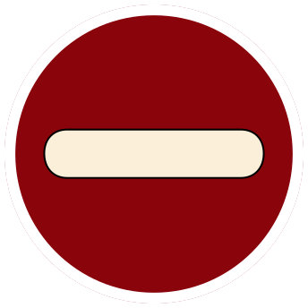

# Janeway — Rules

Rules wording and values are retained from [rules.txt](rules.txt). Presentation was checked against fresh Chrome renders of the linked primary SVGs. SVG differences are noted separately; they do not change the rules below.

This file uses Markdown headings with HTML rule blocks for alignment, spacing, colors, and inline icons. Use a Markdown viewer that supports inline HTML and CSS. Viewers that sanitize styles, including GitHub, may simplify the appearance. Existing SVGs remain the reference for exact artwork, print dimensions, and layout.

The rule blocks use Avenir Next Condensed for rules and Gardablack for headings, scaled for screen reading. Observed SVG line breaks are followed where the wording matches; text absent from the SVG retains its source paragraph. Blue (`#336A9C`) and orange (`#EB943A`) text follow the observed SVG emphasis, including partial phase-name coloring. Icons link to the existing originals. Numbered icons keep their value editable in HTML.

## LEAFLET

### COFFEE

SVG reference: [leaflet.svg](leaflet.svg)

<!-- SVG presentation: left-aligned rules; Avenir Next Condensed Regular; observed local text size 46 SVG units (before group transforms). HTML uses a readable 20px scale. -->

COFFEE

Positive Status Effect | Stack limit: 5

Spend to gain 

Once per turn during your Main Phase, spend these tokens for one of the following effects:

Spend 1: Gain .

Spend 2: Roll one  and gain half the roll value (rounded up) as .

### COMMAND CODES

SVG reference: [leaflet.svg](leaflet.svg)

> **SVG difference:** The SVG omits the introductory line “Spend to modify dice”. That line is retained here from rules.txt.

<!-- SVG presentation: left-aligned rules; Avenir Next Condensed Regular; observed local text size 46 SVG units (before group transforms). HTML uses a readable 20px scale. -->

COMMAND CODES

Positive Status Effect | Stack limit: 5

Spend to modify dice

During any Roll Phase, spend Command Codes for one effect:

Spend 1: Reroll any one of your own dice.

Spend 4: Select one of your opponents dice to force them to reroll it, or change any one of your dice to any value except six.

Spend 5: Change one of your dice to a six.

### REPRIMAND

SVG reference: [leaflet.svg](leaflet.svg)

> **SVG difference:** The SVG omits the introductory line “Make Roll Action Cards cost additional {cp.svg}”. That line is retained here from rules.txt.

<!-- SVG presentation: left-aligned rules; Avenir Next Condensed Regular; observed local text size 46 SVG units (before group transforms). HTML uses a readable 20px scale. -->

REPRIMAND

Negative Status Effect | Stack limit: 2

Make Roll Action Cards cost additional 

The next time a player with this token would play a Roll Phase action card, they must pay one extra  for each Reprimand token to play the card. Then remove all Reprimand tokens.

## HERO BOARD

### FIRE PHASERS

SVG reference: [hero_board.svg](hero_board.svg)

<!-- SVG presentation: center-aligned rules; Avenir Next Condensed Regular; observed local text size 37 SVG units (before group transforms). HTML uses a readable 20px scale. -->

FIRE PHASERS

   Deal <b aria-hidden="true">4</b> dmg

    Deal <b aria-hidden="true">5</b> dmg

     Deal <b aria-hidden="true">6</b> dmg

### SHORE LEAVE

SVG reference: [hero_board.svg](hero_board.svg)

<!-- SVG presentation: center-aligned rules; Avenir Next Condensed Regular; observed local text size 37 SVG units (before group transforms). HTML uses a readable 20px scale. -->

SHORE LEAVE

  

- Gain  and 

- Draw 

### DO IT

SVG reference: [hero_board.svg](hero_board.svg)

<!-- SVG presentation: center-aligned rules; Avenir Next Condensed Regular; observed local text size 37 SVG units (before group transforms). HTML uses a readable 20px scale. -->

DO IT

- Deal <b aria-hidden="true">7</b> dmg

- Inflict 

### RED ALERT

SVG reference: [hero_board.svg](hero_board.svg)

<!-- SVG presentation: center-aligned rules; Avenir Next Condensed Regular; observed local text size 37 SVG units (before group transforms). HTML uses a readable 20px scale. -->

RED ALERT

   

- Gain  and 

- Inflict 

- Deal <b aria-hidden="true">7</b> dmg

### TACTICAL EXERCISES

SVG reference: [hero_board.svg](hero_board.svg)

<!-- SVG presentation: center-aligned rules; Avenir Next Condensed Regular; observed local text size 37 SVG units (before group transforms). HTML uses a readable 20px scale. -->

TACTICAL EXERCISES

    

Roll 2  for the following effects:

- For each  Deal <b aria-hidden="true">4</b> dmg

- On  Gain 2  and 1 

- On  Draw 

- On   Begin a new Offensive Roll Phase targeting the same opponent

You may spend 1  before rolling to roll 3  instead of 2

### COMMAND PROTOCOL

SVG reference: [hero_board.svg](hero_board.svg)

<!-- SVG presentation: center-aligned rules; Avenir Next Condensed Regular; observed local text size 37 SVG units (before group transforms). HTML uses a readable 20px scale. -->

COMMAND PROTOCOL

    

- Deal <b aria-hidden="true">2</b> dmg. You may spend up to 2  to add <b aria-hidden="true">4</b> dmg per  spent

- You may spend 3  to make this attack undefendable

### GET OFF MY SHIP!

SVG reference: [hero_board.svg](hero_board.svg)

<!-- SVG presentation: center-aligned rules; Avenir Next Condensed Regular; observed local text size 37 SVG units (before group transforms). HTML uses a readable 20px scale. -->

GET OFF MY SHIP!

- Deal <b aria-hidden="true">7</b> dmg, then roll 3 

- For each , add  dmg

- On , inflict 

- On , gain  or 

- On   , ignore the previously mentioned effects and instead add <b aria-hidden="true">3</b> dmg and make the attack undefendable

### SHIELDS UP

SVG reference: [hero_board.svg](hero_board.svg)

<!-- SVG presentation: center-aligned rules; Avenir Next Condensed Regular; observed local text size 37 SVG units (before group transforms). HTML uses a readable 20px scale. -->

SHIELDS UP

Roll 3 

- On  prevent 

- On  prevent <b aria-hidden="true">2</b>

- On   Inflict 

### PUNCH YOUR WAY THROUGH (ULTIMATE)

SVG reference: [hero_board.svg](hero_board.svg)

<!-- SVG presentation: center-aligned rules; Avenir Next Condensed Regular; observed local text size 37 SVG units (before group transforms). HTML uses a readable 20px scale. -->

PUNCH YOUR WAY THROUGH (ULTIMATE)

    

- Gain 3 , gain 3 , and inflict 2 

- Then deal <b aria-hidden="true">12</b> dmg

Dice may be altered to prevent an Ultimate. Otherwise, no action of any kind may be performed by any opponent until the ability fully completes.

## CARDS

The first 18 cards in Janeway's deck are standard Dice Throne cards and are omitted here. The cards below are Janeway-specific.

### DETERMINATION

SVG reference: [cards/determination.svg](cards/determination.svg)

<!-- SVG presentation: center-aligned rules; Avenir Next Condensed Regular; observed local text size 37.5 SVG units (before group transforms). HTML uses a readable 20px scale. -->

DETERMINATION

Cost: <b aria-hidden="true">2</b> | Roll Phase Action

A chosen player may perform an additional Roll Attempt of up to three  during their Offensive or Defensive Roll Phase

### SET TO KILL

SVG reference: [cards/set_to_kill.svg](cards/set_to_kill.svg)

<!-- SVG presentation: center-aligned rules; Avenir Next Condensed Regular; observed local text size 37.5 SVG units (before group transforms). HTML uses a readable 20px scale. -->

SET TO KILL

Cost: <b aria-hidden="true">3</b> | Roll Phase Action

You may remove up to 2  to add <b aria-hidden="true">3</b> dmg per  removed

You may remove 3  to make this attack undefendable (Attack modifier)

### COUNTERPOINT

SVG reference: [cards/counterpoint.svg](cards/counterpoint.svg)

<!-- SVG presentation: center-aligned rules; Avenir Next Condensed Regular; observed local text size 37.5 SVG units (before group transforms). HTML uses a readable 20px scale. -->

COUNTERPOINT

Cost: <b aria-hidden="true">3</b> | Roll Phase Action

(Play only after being attacked)

Prevent <b aria-hidden="true">3</b> incoming dmg, and deal <b aria-hidden="true">3</b> dmg to the attacking player

### THERE'S COFFEE IN THAT NEBULA

SVG reference: [cards/theres_coffee_in_that_nebula.svg](cards/theres_coffee_in_that_nebula.svg)

<!-- SVG presentation: center-aligned rules; Avenir Next Condensed Regular; observed local text size 37.5 SVG units (before group transforms). HTML uses a readable 20px scale. -->

THERE&#x27;S COFFEE IN THAT NEBULA

Cost: <b aria-hidden="true">0</b> | Main Phase Action

Roll 1  and gain half the value (rounded up) in 

### COMMAND TRAINING

SVG reference: [cards/command_training.svg](cards/command_training.svg)

<!-- SVG presentation: center-aligned rules; Avenir Next Condensed Regular; observed local text size 37.5 SVG units (before group transforms). HTML uses a readable 20px scale. -->

COMMAND TRAINING

Cost:  | Main Phase Action

Gain . You may spend an additional <b aria-hidden="true">4</b> for an additional  per extra <b aria-hidden="true">2</b> spent

### CAPTAIN'S PREROGATIVE

SVG reference: [cards/captains_prerogative.svg](cards/captains_prerogative.svg)

<!-- SVG presentation: center-aligned rules; Avenir Next Condensed Regular; observed local text size 37.5 SVG units (before group transforms). HTML uses a readable 20px scale. -->

CAPTAIN&#x27;S PREROGATIVE

Cost: <b aria-hidden="true">3</b> | Main Phase Action

Can only be played during your first Main Phase. You may skip your Offensive Roll Phase and instead roll 1 , and heal the total roll value

### REPRIMANDED

SVG reference: [cards/reprimanded.svg](cards/reprimanded.svg)

<!-- SVG presentation: center-aligned rules; Avenir Next Condensed Regular; observed local text size 37.5 SVG units (before group transforms). HTML uses a readable 20px scale. -->

REPRIMANDED

Cost: <b aria-hidden="true">3</b> | Instant Action

Inflict  on two players. (Can be two different players or the same player twice)

### RESOLVE

SVG reference: [cards/resolve.svg](cards/resolve.svg)

<!-- SVG presentation: center-aligned rules; Avenir Next Condensed Regular; observed local text size 16 SVG units (before group transforms). HTML uses a readable 20px scale. -->

RESOLVE

Cost: <b aria-hidden="true">3</b> | Instant Action

Roll 3  for the following effects:

For each , Gain 

For each , Gain 

On , <b aria-hidden="true">6</b>

On  , Also gain  and 

### FIRE PHASERS II

SVG reference: [cards/fire_phasers_ii.svg](cards/fire_phasers_ii.svg)

<!-- SVG presentation: center-aligned rules; Avenir Next Condensed Regular; observed local text size 37 SVG units (before group transforms). HTML uses a readable 20px scale. -->

FIRE PHASERS II

Cost: <b aria-hidden="true">2</b> | Main Phase Action

-    Deal <b aria-hidden="true">5</b> dmg

-     Deal <b aria-hidden="true">6</b> dmg

-      Deal <b aria-hidden="true">7</b> dmg

### FIRE PHASERS III

SVG reference: [cards/fire_phasers_iii.svg](cards/fire_phasers_iii.svg)

<!-- SVG presentation: center-aligned rules; Avenir Next Condensed Regular; observed local text size 37 SVG units (before group transforms). HTML uses a readable 20px scale. -->

FIRE PHASERS III

Cost: <b aria-hidden="true">3</b> | Main Phase Action

-    Deal <b aria-hidden="true">6</b> dmg

-     Deal <b aria-hidden="true">7</b> dmg

-      Deal <b aria-hidden="true">8</b> dmg

- Inflict 

### SHORE LEAVE II

SVG reference: [cards/shore_leave_ii.svg](cards/shore_leave_ii.svg)

<!-- SVG presentation: center-aligned rules; Avenir Next Condensed Regular; observed local text size 37 SVG units (before group transforms). HTML uses a readable 20px scale. -->

SHORE LEAVE II

Cost: <b aria-hidden="true">2</b> | Main Phase Action

  

- Gain 2  and 2 

- Draw 

### TACTICAL EXERCISES II

SVG reference: [cards/tactical_exercises_ii.svg](cards/tactical_exercises_ii.svg)

<!-- SVG presentation: center-aligned rules; Avenir Next Condensed Regular; observed local text size 37 SVG units (before group transforms). HTML uses a readable 20px scale. -->

TACTICAL EXERCISES II

Cost: <b aria-hidden="true">3</b> | Main Phase Action

    

Roll 3  for the following effects:

- For each  Deal <b aria-hidden="true">4</b> dmg

- On  Gain 2  and 1 

- On  Draw 

- On   Begin a new Offensive Roll Phase targeting the same opponent

### SHIELDS UP II

SVG reference: [cards/shields_up_ii.svg](cards/shields_up_ii.svg)

<!-- SVG presentation: center-aligned rules; Avenir Next Condensed Regular; observed local text size 37 SVG units (before group transforms). HTML uses a readable 20px scale. -->

SHIELDS UP II

Cost: <b aria-hidden="true">3</b> | Main Phase Action

Roll 4 :

- For each  prevent 

- On  prevent <b aria-hidden="true">2</b>

- On   Inflict 

### SHIELDS UP III

SVG reference: [cards/shields_up_iii.svg](cards/shields_up_iii.svg)

<!-- SVG presentation: center-aligned rules; Avenir Next Condensed Regular; observed local text size 37 SVG units (before group transforms). HTML uses a readable 20px scale. -->

SHIELDS UP III

Cost: <b aria-hidden="true">4</b> | Main Phase Action

Roll 5 :

- For each  prevent 

- For each  prevent <b aria-hidden="true">2</b>

- On   Inflict 

