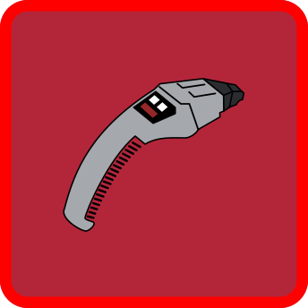
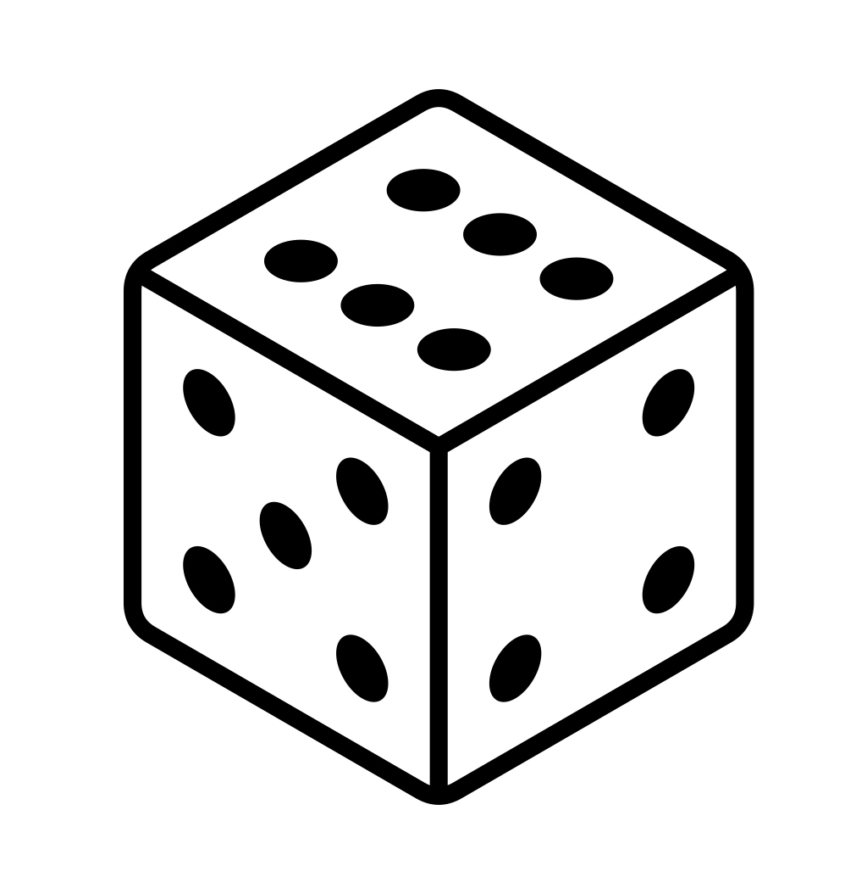
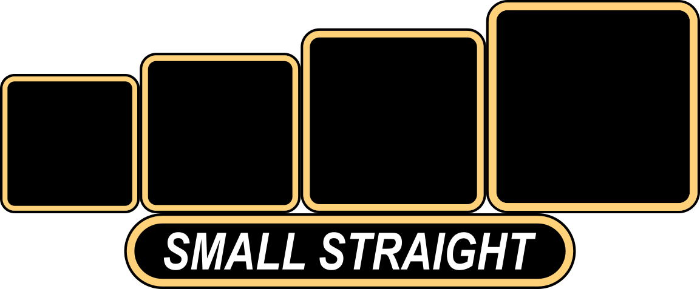

# Tuvok — Rules

Rules wording and values are retained from [rules.txt](rules.txt). Presentation was checked against fresh Chrome renders of the linked primary SVGs. SVG differences are noted separately; they do not change the rules below.

This file uses Markdown headings with HTML rule blocks for alignment, spacing, colors, and inline icons. Use a Markdown viewer that supports inline HTML and CSS. Viewers that sanitize styles, including GitHub, may simplify the appearance. Existing SVGs remain the reference for exact artwork, print dimensions, and layout.

The rule blocks use Avenir Next Condensed for rules and Gardablack for headings, scaled for screen reading. Observed SVG line breaks are followed where the wording matches; text absent from the SVG retains its source paragraph. Blue (`#336A9C`) and orange (`#EB943A`) text follow the observed SVG emphasis, including partial phase-name coloring. Icons link to the existing originals. Numbered icons keep their value editable in HTML.

## LEAFLET

### MIND MELD

SVG reference: [leaflet.svg](leaflet.svg)

<!-- SVG presentation: left-aligned rules; Avenir Next Condensed Regular; observed local text size 39 SVG units (before group transforms). HTML uses a readable 20px scale. -->

MIND MELD

Unique Status Effect | Stack limit: 1

Spend this token during your Main Phase or an opponent&#x27;s Offensive Roll Phase.

During your Main Phase: choose an opponent. They must reveal their hand to you.

During an opponent&#x27;s Offensive Roll Phase: spend this before their first reroll. You can control their first reroll attempt or force them to skip it.

(This token may not be removed or transferred by any means.)

### LOGIC

SVG reference: [leaflet.svg](leaflet.svg)

<!-- SVG presentation: left-aligned rules; Avenir Next Condensed Regular; observed local text size 37 SVG units (before group transforms). HTML uses a readable 20px scale. -->

LOGIC

Positive Status Effect | Stack limit: 5

You may activate one of these effects per turn.

Spend x: During any Roll Phase add x or prevent x

Spend 2: During Upkeep Phase look at the top card of your deck. Put it back on top or bottom

Spend 3: During Upkeep Phase gain  or draw 

Spend 4: During Main Phase gain  or inflict 

### TARGETED

SVG reference: [leaflet.svg](leaflet.svg)

<!-- SVG presentation: left-aligned rules; Avenir Next Condensed Regular; observed local text size 38 SVG units (before group transforms). HTML uses a readable 20px scale. -->

TARGETED

Negative Status Effect | Stack limit: 1

When a player afflicted with this token is attacked by an opponent, the attacker increases their damage by 2. This is an Attack Modifier and persists until removed.

### PROTECT

SVG reference: [leaflet.svg](leaflet.svg)

<!-- SVG presentation: left-aligned rules; Avenir Next Condensed Regular; observed local text size 38 SVG units (before group transforms). HTML uses a readable 20px scale. -->

PROTECT

Positive Status Effect | Stack limit: 1

A player with this token may spend it at any time to prevent half of their incoming damage, rounded up. If two Protect tokens are spent against the same attack, both independently halve the damage. Protect gained from a Defensive Ability may be spent immediately.

## HERO BOARD

### NERVE PINCH

SVG reference: [hero_board.svg](hero_board.svg)

<!-- SVG presentation: center-aligned rules; Avenir Next Condensed Regular; observed local text size 41.625 SVG units (before group transforms). HTML uses a readable 20px scale. -->

NERVE PINCH

 Deal <b aria-hidden="true">5</b>

 Deal <b aria-hidden="true">6</b>

 Deal <b aria-hidden="true">7</b>

### MEDITATE

SVG reference: [hero_board.svg](hero_board.svg)

<!-- SVG presentation: center-aligned rules; Avenir Next Condensed Regular; observed local text size 41.625 SVG units (before group transforms). HTML uses a readable 20px scale. -->

MEDITATE

Roll 4 :

For each  gain 

On  gain 

### MEASURED RESPONSE

SVG reference: [hero_board.svg](hero_board.svg)

<!-- SVG presentation: center-aligned rules; Avenir Next Condensed Regular; observed local text size 41.625 SVG units (before group transforms). HTML uses a readable 20px scale. -->

MEASURED RESPONSE

Roll 3 :

Gain x and deal <b aria-hidden="true">6</b>

### TACTICAL PRECISION

SVG reference: [hero_board.svg](hero_board.svg)

<!-- SVG presentation: center-aligned rules; Avenir Next Condensed Regular; observed local text size 41.625 SVG units (before group transforms). HTML uses a readable 20px scale. -->

TACTICAL PRECISION

Gain 2 , inflict ,

then deal <b aria-hidden="true">8</b>

### COMBAT DRILL

SVG reference: [hero_board.svg](hero_board.svg)

<!-- SVG presentation: center-aligned rules; Avenir Next Condensed Regular; observed local text size 41.625 SVG units (before group transforms). HTML uses a readable 20px scale. -->

COMBAT DRILL

Deal <b aria-hidden="true">4</b>

Up to 3  may be spent to add <b aria-hidden="true">2</b> each. Additional  may be spent to add the standard 

### FINAL CALCULATION

SVG reference: [hero_board.svg](hero_board.svg)

> **SVG difference:** rules.txt specifies 8 initial damage; the saved SVG shows 6. This document retains 8.

<!-- SVG presentation: center-aligned rules; Avenir Next Condensed Regular; observed local text size 41.625 SVG units (before group transforms). HTML uses a readable 20px scale. -->

FINAL CALCULATION

Deal <b aria-hidden="true">8</b>, then roll 2 

On  add <b aria-hidden="true">2</b>

On  add <b aria-hidden="true">3</b>

On  add <b aria-hidden="true">4</b>

On  make this attack undefendable

### KOLINAR (PASSIVE)

SVG reference: [hero_board.svg](hero_board.svg)

<!-- SVG presentation: center-aligned rules; Avenir Next Condensed Regular; observed local text size 41.625 SVG units (before group transforms). HTML uses a readable 20px scale. -->

KOLINAR (PASSIVE)

During your Upkeep Phase, gain 

### RETURN FIRE

SVG reference: [hero_board.svg](hero_board.svg)

> **SVG difference:** The saved SVG includes an additional Salute result dealing 2 damage back and uses “back” after the Phaser damage. Those additions are absent from rules.txt and have not been added here.

<!-- SVG presentation: center-aligned rules; Avenir Next Condensed Regular; observed local text size 41.625 SVG units (before group transforms). HTML uses a readable 20px scale. -->

RETURN FIRE

Roll 3 :

For each  deal 

On  gain 

### LOGICAL OUTCOME (ULTIMATE)

SVG reference: [hero_board.svg](hero_board.svg)

> **SVG difference:** rules.txt grants 4 Logic; the saved SVG shows 2. This document retains 4. The original SVG’s standard Ultimate restriction note is displayed separately as an asset note; it is not added to gameplay rules.

<!-- Ultimate presentation: left-aligned, single-line effects at 49.95 effective SVG units; left-aligned disclaimer at 30.375 effective SVG units. Preserve source transforms and disclaimer breaks; do not apply regular-panel defaults. -->

LOGICAL OUTCOME (ULTIMATE)

Increase Logic stack limit by 1, gain  and 4 , then deal <b aria-hidden="true">12</b>

Dice may be altered to prevent an Ultimate. Otherwise, no action of any kind may be performed by an opponent until the ability fully completes.

## CARDS

The first 18 cards in Tuvok's deck are standard Dice Throne cards and are omitted here. The cards below are Tuvok-specific.

### TACTICAL RECALIBRATION

SVG reference: [cards/tactical_recalibration.svg](cards/tactical_recalibration.svg)

<!-- SVG presentation: center-aligned rules; Avenir Next Condensed Regular; observed local text size 37.5 SVG units (before group transforms). HTML uses a readable 20px scale. -->

TACTICAL RECALIBRATION

Cost:  | Roll Phase Action

During your Offensive Roll Phase, after a roll attempt, reroll one die.

### VULCAN COMPOSURE

SVG reference: [cards/vulcan_composure.svg](cards/vulcan_composure.svg)

<!-- SVG presentation: center-aligned rules; Avenir Next Condensed Regular; observed local text size 37.5 SVG units (before group transforms). HTML uses a readable 20px scale. -->

VULCAN COMPOSURE

Cost: <b aria-hidden="true">2</b> | Roll Phase Action

During your Defensive Roll Phase, prevent <b aria-hidden="true">2</b>.

### CALCULATED OPENING

SVG reference: [cards/calculated_opening.svg](cards/calculated_opening.svg)

<!-- SVG presentation: center-aligned rules; Avenir Next Condensed Regular; observed local text size 37.5 SVG units (before group transforms). HTML uses a readable 20px scale. -->

CALCULATED OPENING

Cost: <b aria-hidden="true">2</b> | Roll Phase Action

During your Offensive Roll Phase, gain .

### KAL-TOH

SVG reference: [cards/kal_toh.svg](cards/kal_toh.svg)

<!-- SVG presentation: center-aligned rules; Avenir Next Condensed Regular; observed local text size 37.5 SVG units (before group transforms). HTML uses a readable 20px scale. -->

KAL-TOH

Cost: <b aria-hidden="true">2</b> | Main Phase Action

Look at the top 3 cards of your deck. Put one on the bottom of your deck and return the others to the top in any order.

### SECURITY PROTOCOLS

SVG reference: [cards/security_protocols.svg](cards/security_protocols.svg)

<!-- SVG presentation: center-aligned rules; Avenir Next Condensed Regular; observed local text size 37.5 SVG units (before group transforms). HTML uses a readable 20px scale. -->

SECURITY PROTOCOLS

Cost: <b aria-hidden="true">2</b> | Main Phase Action

Gain , or give  to a teammate.

### KOLINAHR DISCIPLINE

SVG reference: [cards/kolinahr_discipline.svg](cards/kolinahr_discipline.svg)

<!-- SVG presentation: center-aligned rules; Avenir Next Condensed Regular; observed local text size 37.5 SVG units (before group transforms). HTML uses a readable 20px scale. -->

KOLINAHR DISCIPLINE

Cost: <b aria-hidden="true">2</b> | Main Phase Action

Gain 2 .

### MY MIND TO YOUR MIND

SVG reference: [cards/my_mind_to_your_mind.svg](cards/my_mind_to_your_mind.svg)

<!-- SVG presentation: center-aligned rules; Avenir Next Condensed Regular; observed local text size 37.5 SVG units (before group transforms). HTML uses a readable 20px scale. -->

MY MIND TO YOUR MIND

Cost: <b aria-hidden="true">4</b> | Instant Action

Gain  and spend it while being targeted by an opponent.

### MY THOUGHTS TO YOUR THOUGHTS

SVG reference: [cards/my_thoughts_to_your_thoughts.svg](cards/my_thoughts_to_your_thoughts.svg)

<!-- SVG presentation: center-aligned rules; Avenir Next Condensed Regular; observed local text size 37.5 SVG units (before group transforms). HTML uses a readable 20px scale. -->

MY THOUGHTS TO YOUR THOUGHTS

Cost: <b aria-hidden="true">2</b> | Instant Action

Force an opponent to reveal to you two cards from their hand at random. Or, if spent at the same time as My Mind To Your Mind, activate both effects of Mind Meld at the same time regardless of current phase.

### NERVE PINCH II

SVG reference: [cards/nerve_pinch_ii.svg](cards/nerve_pinch_ii.svg)

<!-- SVG presentation: center-aligned rules; Avenir Next Condensed Regular; observed local text size 37.5 SVG units (before group transforms). HTML uses a readable 20px scale. -->

NERVE PINCH II

Cost: <b aria-hidden="true">2</b> | Upgrade Card

 Deal <b aria-hidden="true">6</b>

 Deal <b aria-hidden="true">7</b>

 Deal <b aria-hidden="true">8</b>

### NERVE PINCH III

SVG reference: [cards/nerve_pinch_iii.svg](cards/nerve_pinch_iii.svg)

<!-- SVG presentation: center-aligned rules; Avenir Next Condensed Regular; observed local text size 37.5 SVG units (before group transforms). HTML uses a readable 20px scale. -->

NERVE PINCH III

Cost: <b aria-hidden="true">4</b> | Upgrade Card

 Deal <b aria-hidden="true">7</b>

 Deal <b aria-hidden="true">8</b>

 Deal <b aria-hidden="true">9</b>

On 4 of a kind, make this attack undefendable.

### KOLINAR II

SVG reference: [cards/kolinar_ii.svg](cards/kolinar_ii.svg)

<!-- SVG presentation: center-aligned rules; Avenir Next Condensed Regular; observed local text size 37.5 SVG units (before group transforms). HTML uses a readable 20px scale. -->

KOLINAR II

Cost: <b aria-hidden="true">2</b> | Upgrade Card

During your Upkeep Phase, roll 1 . On  gain . On  or  gain 2 .

### TACTICAL PRECISION II

SVG reference: [cards/tactical_precision_ii.svg](cards/tactical_precision_ii.svg)

<!-- SVG presentation: center-aligned rules; Avenir Next Condensed Regular; observed local text size 37.5 SVG units (before group transforms). HTML uses a readable 20px scale. -->

TACTICAL PRECISION II

Cost: <b aria-hidden="true">3</b> | Upgrade Card

Top panel: TACTICAL PRECISION II

Gain 2 , inflict ,

then deal <b aria-hidden="true">9</b>

Bottom panel — Targeting Lock:

Inflict  and gain 3 

### RETURN FIRE II

SVG reference: [cards/return_fire_ii.svg](cards/return_fire_ii.svg)

> **SVG difference:** rules.txt specifies Roll 4 and 1 damage per Phaser; the saved SVG shows Roll 3 and 2 damage per Phaser, plus an additional Salute result dealing 2 damage back. This document retains the rules.txt values and effects.

<!-- SVG presentation: center-aligned rules; Avenir Next Condensed Regular; observed local text size 37.5 SVG units (before group transforms). HTML uses a readable 20px scale. -->

RETURN FIRE II

Cost: <b aria-hidden="true">3</b> | Upgrade Card

Roll 4 :

For each  deal 

On  gain 

### RETURN FIRE III

SVG reference: [cards/return_fire_iii.svg](cards/return_fire_iii.svg)

> **SVG difference:** rules.txt specifies Roll 5 and 1 damage per Phaser; the saved SVG shows Roll 4 and 2 damage per Phaser, plus an additional Salute result dealing 2 damage back. This document retains the rules.txt values and effects.

<!-- SVG presentation: center-aligned rules; Avenir Next Condensed Regular; observed local text size 37.5 SVG units (before group transforms). HTML uses a readable 20px scale. -->

RETURN FIRE III

Cost: <b aria-hidden="true">5</b> | Upgrade Card

Roll 5 :

For each  deal 

On  gain 

<!-- stdt-icon-inventory:v1
{
  "schema_version": 1,
  "status": "current",
  "source": "rules.md",
  "content_sha256": "54fb57b2f144af44ee2f2f7052da08012b4c67fea49f8cbac6dd550c743c98d3",
  "counting": {
    "scope": "explicit gameplay icon references in rendered rules blocks",
    "excludes": [
      "CP cost/timing metadata",
      "titles",
      "design notes and brainstorming",
      "shared Standard Cards",
      "artwork-only icons"
    ],
    "number": "explicit data-value, or null for an unnumbered reference; excludes intrinsic die labels",
    "references": "occurrences, not quantities of tokens gained, dice rolled, or damage dealt",
    "asset_observations": "separate saved-artwork instances; never added to rules reference totals"
  },
  "coverage": {
    "leaflet": {
      "entries": 4,
      "references": 6
    },
    "hero_board": {
      "entries": 9,
      "references": 73
    },
    "cards": {
      "entries": 14,
      "references": 66
    }
  },
  "total_rules_references": 145,
  "entries": [
    {
      "section": "leaflet",
      "name": "MIND MELD",
      "status": "written",
      "icons": []
    },
    {
      "section": "leaflet",
      "name": "LOGIC",
      "status": "written",
      "icons": [
        {
          "file": "carddraw.svg",
          "path": "../../Shared/icons/carddraw.svg",
          "number": 1,
          "references": 1
        },
        {
          "file": "cp.svg",
          "path": "../../Shared/icons/cp.svg",
          "number": 1,
          "references": 1
        },
        {
          "file": "damage_prevention.svg",
          "path": "../../Shared/icons/damage_prevention.svg",
          "number": 1,
          "references": 1
        },
        {
          "file": "normal_damage.svg",
          "path": "../../Shared/icons/normal_damage.svg",
          "number": 1,
          "references": 1
        },
        {
          "file": "protect.svg",
          "path": "icons/protect.svg",
          "number": null,
          "references": 1
        },
        {
          "file": "targeted.svg",
          "path": "icons/targeted.svg",
          "number": null,
          "references": 1
        }
      ]
    },
    {
      "section": "leaflet",
      "name": "TARGETED",
      "status": "written",
      "icons": []
    },
    {
      "section": "leaflet",
      "name": "PROTECT",
      "status": "written",
      "icons": []
    },
    {
      "section": "hero_board",
      "name": "NERVE PINCH",
      "status": "written",
      "icons": [
        {
          "file": "normal_damage.svg",
          "path": "../../Shared/icons/normal_damage.svg",
          "number": 5,
          "references": 1
        },
        {
          "file": "normal_damage.svg",
          "path": "../../Shared/icons/normal_damage.svg",
          "number": 6,
          "references": 1
        },
        {
          "file": "normal_damage.svg",
          "path": "../../Shared/icons/normal_damage.svg",
          "number": 7,
          "references": 1
        },
        {
          "file": "phaser_die.svg",
          "path": "icons/phaser_die.svg",
          "number": null,
          "references": 12
        }
      ]
    },
    {
      "section": "hero_board",
      "name": "MEDITATE",
      "status": "written",
      "icons": [
        {
          "file": "idic_die.svg",
          "path": "icons/idic_die.svg",
          "number": null,
          "references": 2
        },
        {
          "file": "logic.svg",
          "path": "icons/logic.svg",
          "number": null,
          "references": 1
        },
        {
          "file": "phaser_die.svg",
          "path": "icons/phaser_die.svg",
          "number": null,
          "references": 1
        },
        {
          "file": "protect.svg",
          "path": "icons/protect.svg",
          "number": null,
          "references": 1
        },
        {
          "file": "roll_die.svg",
          "path": "../../Shared/icons/roll_die.svg",
          "number": null,
          "references": 1
        },
        {
          "file": "salute_die.svg",
          "path": "icons/salute_die.svg",
          "number": null,
          "references": 3
        }
      ]
    },
    {
      "section": "hero_board",
      "name": "MEASURED RESPONSE",
      "status": "written",
      "icons": [
        {
          "file": "logic.svg",
          "path": "icons/logic.svg",
          "number": null,
          "references": 1
        },
        {
          "file": "normal_damage.svg",
          "path": "../../Shared/icons/normal_damage.svg",
          "number": 6,
          "references": 1
        },
        {
          "file": "phaser_die.svg",
          "path": "icons/phaser_die.svg",
          "number": null,
          "references": 1
        },
        {
          "file": "roll_die.svg",
          "path": "../../Shared/icons/roll_die.svg",
          "number": null,
          "references": 1
        },
        {
          "file": "smallstraight.svg",
          "path": "../../Shared/icons/smallstraight.svg",
          "number": null,
          "references": 1
        }
      ]
    },
    {
      "section": "hero_board",
      "name": "TACTICAL PRECISION",
      "status": "written",
      "icons": [
        {
          "file": "idic_die.svg",
          "path": "icons/idic_die.svg",
          "number": null,
          "references": 4
        },
        {
          "file": "logic.svg",
          "path": "icons/logic.svg",
          "number": null,
          "references": 1
        },
        {
          "file": "targeted.svg",
          "path": "icons/targeted.svg",
          "number": null,
          "references": 1
        },
        {
          "file": "undefendable_damage.svg",
          "path": "../../Shared/icons/undefendable_damage.svg",
          "number": 8,
          "references": 1
        }
      ]
    },
    {
      "section": "hero_board",
      "name": "COMBAT DRILL",
      "status": "written",
      "icons": [
        {
          "file": "logic.svg",
          "path": "icons/logic.svg",
          "number": null,
          "references": 2
        },
        {
          "file": "normal_damage.svg",
          "path": "../../Shared/icons/normal_damage.svg",
          "number": 1,
          "references": 1
        },
        {
          "file": "normal_damage.svg",
          "path": "../../Shared/icons/normal_damage.svg",
          "number": 2,
          "references": 1
        },
        {
          "file": "normal_damage.svg",
          "path": "../../Shared/icons/normal_damage.svg",
          "number": 4,
          "references": 1
        },
        {
          "file": "phaser_die.svg",
          "path": "icons/phaser_die.svg",
          "number": null,
          "references": 3
        },
        {
          "file": "salute_die.svg",
          "path": "icons/salute_die.svg",
          "number": null,
          "references": 2
        }
      ]
    },
    {
      "section": "hero_board",
      "name": "FINAL CALCULATION",
      "status": "written",
      "icons": [
        {
          "file": "idic_die.svg",
          "path": "icons/idic_die.svg",
          "number": null,
          "references": 3
        },
        {
          "file": "largestraight.svg",
          "path": "../../Shared/icons/largestraight.svg",
          "number": null,
          "references": 1
        },
        {
          "file": "normal_damage.svg",
          "path": "../../Shared/icons/normal_damage.svg",
          "number": 2,
          "references": 1
        },
        {
          "file": "normal_damage.svg",
          "path": "../../Shared/icons/normal_damage.svg",
          "number": 3,
          "references": 1
        },
        {
          "file": "normal_damage.svg",
          "path": "../../Shared/icons/normal_damage.svg",
          "number": 4,
          "references": 1
        },
        {
          "file": "normal_damage.svg",
          "path": "../../Shared/icons/normal_damage.svg",
          "number": 8,
          "references": 1
        },
        {
          "file": "phaser_die.svg",
          "path": "icons/phaser_die.svg",
          "number": null,
          "references": 1
        },
        {
          "file": "roll_die.svg",
          "path": "../../Shared/icons/roll_die.svg",
          "number": null,
          "references": 1
        },
        {
          "file": "salute_die.svg",
          "path": "icons/salute_die.svg",
          "number": null,
          "references": 1
        }
      ]
    },
    {
      "section": "hero_board",
      "name": "KOLINAR (PASSIVE)",
      "status": "written",
      "icons": [
        {
          "file": "logic.svg",
          "path": "icons/logic.svg",
          "number": null,
          "references": 1
        }
      ]
    },
    {
      "section": "hero_board",
      "name": "RETURN FIRE",
      "status": "written",
      "icons": [
        {
          "file": "defense_3_dice.svg",
          "path": "../../Shared/icons/defense_3_dice.svg",
          "number": null,
          "references": 1
        },
        {
          "file": "idic_die.svg",
          "path": "icons/idic_die.svg",
          "number": null,
          "references": 2
        },
        {
          "file": "normal_damage.svg",
          "path": "../../Shared/icons/normal_damage.svg",
          "number": 1,
          "references": 1
        },
        {
          "file": "phaser_die.svg",
          "path": "icons/phaser_die.svg",
          "number": null,
          "references": 1
        },
        {
          "file": "protect.svg",
          "path": "icons/protect.svg",
          "number": null,
          "references": 1
        },
        {
          "file": "roll_die.svg",
          "path": "../../Shared/icons/roll_die.svg",
          "number": null,
          "references": 1
        }
      ]
    },
    {
      "section": "hero_board",
      "name": "LOGICAL OUTCOME (ULTIMATE)",
      "status": "written",
      "icons": [
        {
          "file": "idic_die.svg",
          "path": "icons/idic_die.svg",
          "number": null,
          "references": 5
        },
        {
          "file": "logic.svg",
          "path": "icons/logic.svg",
          "number": null,
          "references": 1
        },
        {
          "file": "mind_meld.svg",
          "path": "icons/mind_meld.svg",
          "number": null,
          "references": 1
        },
        {
          "file": "undefendable_damage.svg",
          "path": "../../Shared/icons/undefendable_damage.svg",
          "number": 12,
          "references": 1
        }
      ]
    },
    {
      "section": "cards",
      "name": "TACTICAL RECALIBRATION",
      "status": "written",
      "icons": []
    },
    {
      "section": "cards",
      "name": "VULCAN COMPOSURE",
      "status": "written",
      "icons": [
        {
          "file": "damage_prevention.svg",
          "path": "../../Shared/icons/damage_prevention.svg",
          "number": 2,
          "references": 1
        }
      ]
    },
    {
      "section": "cards",
      "name": "CALCULATED OPENING",
      "status": "written",
      "icons": [
        {
          "file": "logic.svg",
          "path": "icons/logic.svg",
          "number": null,
          "references": 1
        }
      ]
    },
    {
      "section": "cards",
      "name": "KAL-TOH",
      "status": "written",
      "icons": []
    },
    {
      "section": "cards",
      "name": "SECURITY PROTOCOLS",
      "status": "written",
      "icons": [
        {
          "file": "protect.svg",
          "path": "icons/protect.svg",
          "number": null,
          "references": 2
        }
      ]
    },
    {
      "section": "cards",
      "name": "KOLINAHR DISCIPLINE",
      "status": "written",
      "icons": [
        {
          "file": "logic.svg",
          "path": "icons/logic.svg",
          "number": null,
          "references": 1
        }
      ]
    },
    {
      "section": "cards",
      "name": "MY MIND TO YOUR MIND",
      "status": "written",
      "icons": [
        {
          "file": "mind_meld.svg",
          "path": "icons/mind_meld.svg",
          "number": null,
          "references": 1
        }
      ]
    },
    {
      "section": "cards",
      "name": "MY THOUGHTS TO YOUR THOUGHTS",
      "status": "written",
      "icons": []
    },
    {
      "section": "cards",
      "name": "NERVE PINCH II",
      "status": "written",
      "icons": [
        {
          "file": "normal_damage.svg",
          "path": "../../Shared/icons/normal_damage.svg",
          "number": 6,
          "references": 1
        },
        {
          "file": "normal_damage.svg",
          "path": "../../Shared/icons/normal_damage.svg",
          "number": 7,
          "references": 1
        },
        {
          "file": "normal_damage.svg",
          "path": "../../Shared/icons/normal_damage.svg",
          "number": 8,
          "references": 1
        },
        {
          "file": "phaser_die.svg",
          "path": "icons/phaser_die.svg",
          "number": null,
          "references": 12
        }
      ]
    },
    {
      "section": "cards",
      "name": "NERVE PINCH III",
      "status": "written",
      "icons": [
        {
          "file": "normal_damage.svg",
          "path": "../../Shared/icons/normal_damage.svg",
          "number": 7,
          "references": 1
        },
        {
          "file": "normal_damage.svg",
          "path": "../../Shared/icons/normal_damage.svg",
          "number": 8,
          "references": 1
        },
        {
          "file": "normal_damage.svg",
          "path": "../../Shared/icons/normal_damage.svg",
          "number": 9,
          "references": 1
        },
        {
          "file": "phaser_die.svg",
          "path": "icons/phaser_die.svg",
          "number": null,
          "references": 12
        }
      ]
    },
    {
      "section": "cards",
      "name": "KOLINAR II",
      "status": "written",
      "icons": [
        {
          "file": "idic_die.svg",
          "path": "icons/idic_die.svg",
          "number": null,
          "references": 1
        },
        {
          "file": "logic.svg",
          "path": "icons/logic.svg",
          "number": null,
          "references": 2
        },
        {
          "file": "phaser_die.svg",
          "path": "icons/phaser_die.svg",
          "number": null,
          "references": 1
        },
        {
          "file": "roll_die.svg",
          "path": "../../Shared/icons/roll_die.svg",
          "number": null,
          "references": 1
        },
        {
          "file": "salute_die.svg",
          "path": "icons/salute_die.svg",
          "number": null,
          "references": 1
        }
      ]
    },
    {
      "section": "cards",
      "name": "TACTICAL PRECISION II",
      "status": "written",
      "icons": [
        {
          "file": "idic_die.svg",
          "path": "icons/idic_die.svg",
          "number": null,
          "references": 7
        },
        {
          "file": "logic.svg",
          "path": "icons/logic.svg",
          "number": null,
          "references": 2
        },
        {
          "file": "targeted.svg",
          "path": "icons/targeted.svg",
          "number": null,
          "references": 2
        },
        {
          "file": "undefendable_damage.svg",
          "path": "../../Shared/icons/undefendable_damage.svg",
          "number": 9,
          "references": 1
        }
      ]
    },
    {
      "section": "cards",
      "name": "RETURN FIRE II",
      "status": "written",
      "icons": [
        {
          "file": "idic_die.svg",
          "path": "icons/idic_die.svg",
          "number": null,
          "references": 2
        },
        {
          "file": "normal_damage.svg",
          "path": "../../Shared/icons/normal_damage.svg",
          "number": 1,
          "references": 1
        },
        {
          "file": "phaser_die.svg",
          "path": "icons/phaser_die.svg",
          "number": null,
          "references": 1
        },
        {
          "file": "protect.svg",
          "path": "icons/protect.svg",
          "number": null,
          "references": 1
        },
        {
          "file": "roll_die.svg",
          "path": "../../Shared/icons/roll_die.svg",
          "number": null,
          "references": 1
        }
      ]
    },
    {
      "section": "cards",
      "name": "RETURN FIRE III",
      "status": "written",
      "icons": [
        {
          "file": "idic_die.svg",
          "path": "icons/idic_die.svg",
          "number": null,
          "references": 2
        },
        {
          "file": "normal_damage.svg",
          "path": "../../Shared/icons/normal_damage.svg",
          "number": 1,
          "references": 1
        },
        {
          "file": "phaser_die.svg",
          "path": "icons/phaser_die.svg",
          "number": null,
          "references": 1
        },
        {
          "file": "protect.svg",
          "path": "icons/protect.svg",
          "number": null,
          "references": 1
        },
        {
          "file": "roll_die.svg",
          "path": "../../Shared/icons/roll_die.svg",
          "number": null,
          "references": 1
        }
      ]
    }
  ],
  "usage_by_icon": {
    "carddraw.svg": [
      {
        "section": "leaflet",
        "entry": "LOGIC",
        "number": 1,
        "references": 1
      }
    ],
    "cp.svg": [
      {
        "section": "leaflet",
        "entry": "LOGIC",
        "number": 1,
        "references": 1
      }
    ],
    "damage_prevention.svg": [
      {
        "section": "leaflet",
        "entry": "LOGIC",
        "number": 1,
        "references": 1
      },
      {
        "section": "cards",
        "entry": "VULCAN COMPOSURE",
        "number": 2,
        "references": 1
      }
    ],
    "defense_3_dice.svg": [
      {
        "section": "hero_board",
        "entry": "RETURN FIRE",
        "number": null,
        "references": 1
      }
    ],
    "idic_die.svg": [
      {
        "section": "hero_board",
        "entry": "MEDITATE",
        "number": null,
        "references": 2
      },
      {
        "section": "hero_board",
        "entry": "TACTICAL PRECISION",
        "number": null,
        "references": 4
      },
      {
        "section": "hero_board",
        "entry": "FINAL CALCULATION",
        "number": null,
        "references": 3
      },
      {
        "section": "hero_board",
        "entry": "RETURN FIRE",
        "number": null,
        "references": 2
      },
      {
        "section": "hero_board",
        "entry": "LOGICAL OUTCOME (ULTIMATE)",
        "number": null,
        "references": 5
      },
      {
        "section": "cards",
        "entry": "KOLINAR II",
        "number": null,
        "references": 1
      },
      {
        "section": "cards",
        "entry": "TACTICAL PRECISION II",
        "number": null,
        "references": 7
      },
      {
        "section": "cards",
        "entry": "RETURN FIRE II",
        "number": null,
        "references": 2
      },
      {
        "section": "cards",
        "entry": "RETURN FIRE III",
        "number": null,
        "references": 2
      }
    ],
    "largestraight.svg": [
      {
        "section": "hero_board",
        "entry": "FINAL CALCULATION",
        "number": null,
        "references": 1
      }
    ],
    "logic.svg": [
      {
        "section": "hero_board",
        "entry": "MEDITATE",
        "number": null,
        "references": 1
      },
      {
        "section": "hero_board",
        "entry": "MEASURED RESPONSE",
        "number": null,
        "references": 1
      },
      {
        "section": "hero_board",
        "entry": "TACTICAL PRECISION",
        "number": null,
        "references": 1
      },
      {
        "section": "hero_board",
        "entry": "COMBAT DRILL",
        "number": null,
        "references": 2
      },
      {
        "section": "hero_board",
        "entry": "KOLINAR (PASSIVE)",
        "number": null,
        "references": 1
      },
      {
        "section": "hero_board",
        "entry": "LOGICAL OUTCOME (ULTIMATE)",
        "number": null,
        "references": 1
      },
      {
        "section": "cards",
        "entry": "CALCULATED OPENING",
        "number": null,
        "references": 1
      },
      {
        "section": "cards",
        "entry": "KOLINAHR DISCIPLINE",
        "number": null,
        "references": 1
      },
      {
        "section": "cards",
        "entry": "KOLINAR II",
        "number": null,
        "references": 2
      },
      {
        "section": "cards",
        "entry": "TACTICAL PRECISION II",
        "number": null,
        "references": 2
      }
    ],
    "mind_meld.svg": [
      {
        "section": "hero_board",
        "entry": "LOGICAL OUTCOME (ULTIMATE)",
        "number": null,
        "references": 1
      },
      {
        "section": "cards",
        "entry": "MY MIND TO YOUR MIND",
        "number": null,
        "references": 1
      }
    ],
    "normal_damage.svg": [
      {
        "section": "leaflet",
        "entry": "LOGIC",
        "number": 1,
        "references": 1
      },
      {
        "section": "hero_board",
        "entry": "NERVE PINCH",
        "number": 5,
        "references": 1
      },
      {
        "section": "hero_board",
        "entry": "NERVE PINCH",
        "number": 6,
        "references": 1
      },
      {
        "section": "hero_board",
        "entry": "NERVE PINCH",
        "number": 7,
        "references": 1
      },
      {
        "section": "hero_board",
        "entry": "MEASURED RESPONSE",
        "number": 6,
        "references": 1
      },
      {
        "section": "hero_board",
        "entry": "COMBAT DRILL",
        "number": 1,
        "references": 1
      },
      {
        "section": "hero_board",
        "entry": "COMBAT DRILL",
        "number": 2,
        "references": 1
      },
      {
        "section": "hero_board",
        "entry": "COMBAT DRILL",
        "number": 4,
        "references": 1
      },
      {
        "section": "hero_board",
        "entry": "FINAL CALCULATION",
        "number": 2,
        "references": 1
      },
      {
        "section": "hero_board",
        "entry": "FINAL CALCULATION",
        "number": 3,
        "references": 1
      },
      {
        "section": "hero_board",
        "entry": "FINAL CALCULATION",
        "number": 4,
        "references": 1
      },
      {
        "section": "hero_board",
        "entry": "FINAL CALCULATION",
        "number": 8,
        "references": 1
      },
      {
        "section": "hero_board",
        "entry": "RETURN FIRE",
        "number": 1,
        "references": 1
      },
      {
        "section": "cards",
        "entry": "NERVE PINCH II",
        "number": 6,
        "references": 1
      },
      {
        "section": "cards",
        "entry": "NERVE PINCH II",
        "number": 7,
        "references": 1
      },
      {
        "section": "cards",
        "entry": "NERVE PINCH II",
        "number": 8,
        "references": 1
      },
      {
        "section": "cards",
        "entry": "NERVE PINCH III",
        "number": 7,
        "references": 1
      },
      {
        "section": "cards",
        "entry": "NERVE PINCH III",
        "number": 8,
        "references": 1
      },
      {
        "section": "cards",
        "entry": "NERVE PINCH III",
        "number": 9,
        "references": 1
      },
      {
        "section": "cards",
        "entry": "RETURN FIRE II",
        "number": 1,
        "references": 1
      },
      {
        "section": "cards",
        "entry": "RETURN FIRE III",
        "number": 1,
        "references": 1
      }
    ],
    "phaser_die.svg": [
      {
        "section": "hero_board",
        "entry": "NERVE PINCH",
        "number": null,
        "references": 12
      },
      {
        "section": "hero_board",
        "entry": "MEDITATE",
        "number": null,
        "references": 1
      },
      {
        "section": "hero_board",
        "entry": "MEASURED RESPONSE",
        "number": null,
        "references": 1
      },
      {
        "section": "hero_board",
        "entry": "COMBAT DRILL",
        "number": null,
        "references": 3
      },
      {
        "section": "hero_board",
        "entry": "FINAL CALCULATION",
        "number": null,
        "references": 1
      },
      {
        "section": "hero_board",
        "entry": "RETURN FIRE",
        "number": null,
        "references": 1
      },
      {
        "section": "cards",
        "entry": "NERVE PINCH II",
        "number": null,
        "references": 12
      },
      {
        "section": "cards",
        "entry": "NERVE PINCH III",
        "number": null,
        "references": 12
      },
      {
        "section": "cards",
        "entry": "KOLINAR II",
        "number": null,
        "references": 1
      },
      {
        "section": "cards",
        "entry": "RETURN FIRE II",
        "number": null,
        "references": 1
      },
      {
        "section": "cards",
        "entry": "RETURN FIRE III",
        "number": null,
        "references": 1
      }
    ],
    "protect.svg": [
      {
        "section": "leaflet",
        "entry": "LOGIC",
        "number": null,
        "references": 1
      },
      {
        "section": "hero_board",
        "entry": "MEDITATE",
        "number": null,
        "references": 1
      },
      {
        "section": "hero_board",
        "entry": "RETURN FIRE",
        "number": null,
        "references": 1
      },
      {
        "section": "cards",
        "entry": "SECURITY PROTOCOLS",
        "number": null,
        "references": 2
      },
      {
        "section": "cards",
        "entry": "RETURN FIRE II",
        "number": null,
        "references": 1
      },
      {
        "section": "cards",
        "entry": "RETURN FIRE III",
        "number": null,
        "references": 1
      }
    ],
    "roll_die.svg": [
      {
        "section": "hero_board",
        "entry": "MEDITATE",
        "number": null,
        "references": 1
      },
      {
        "section": "hero_board",
        "entry": "MEASURED RESPONSE",
        "number": null,
        "references": 1
      },
      {
        "section": "hero_board",
        "entry": "FINAL CALCULATION",
        "number": null,
        "references": 1
      },
      {
        "section": "hero_board",
        "entry": "RETURN FIRE",
        "number": null,
        "references": 1
      },
      {
        "section": "cards",
        "entry": "KOLINAR II",
        "number": null,
        "references": 1
      },
      {
        "section": "cards",
        "entry": "RETURN FIRE II",
        "number": null,
        "references": 1
      },
      {
        "section": "cards",
        "entry": "RETURN FIRE III",
        "number": null,
        "references": 1
      }
    ],
    "salute_die.svg": [
      {
        "section": "hero_board",
        "entry": "MEDITATE",
        "number": null,
        "references": 3
      },
      {
        "section": "hero_board",
        "entry": "COMBAT DRILL",
        "number": null,
        "references": 2
      },
      {
        "section": "hero_board",
        "entry": "FINAL CALCULATION",
        "number": null,
        "references": 1
      },
      {
        "section": "cards",
        "entry": "KOLINAR II",
        "number": null,
        "references": 1
      }
    ],
    "smallstraight.svg": [
      {
        "section": "hero_board",
        "entry": "MEASURED RESPONSE",
        "number": null,
        "references": 1
      }
    ],
    "targeted.svg": [
      {
        "section": "leaflet",
        "entry": "LOGIC",
        "number": null,
        "references": 1
      },
      {
        "section": "hero_board",
        "entry": "TACTICAL PRECISION",
        "number": null,
        "references": 1
      },
      {
        "section": "cards",
        "entry": "TACTICAL PRECISION II",
        "number": null,
        "references": 2
      }
    ],
    "undefendable_damage.svg": [
      {
        "section": "hero_board",
        "entry": "TACTICAL PRECISION",
        "number": 8,
        "references": 1
      },
      {
        "section": "hero_board",
        "entry": "LOGICAL OUTCOME (ULTIMATE)",
        "number": 12,
        "references": 1
      },
      {
        "section": "cards",
        "entry": "TACTICAL PRECISION II",
        "number": 9,
        "references": 1
      }
    ]
  },
  "asset_observations": [
    {
      "file": "leaflet.svg",
      "status": "observed",
      "scope": "die_reference_legend",
      "sha256": "edc2b1b4662268c98693919ca013944dfbdd46fe8826c011ae89c5be3b656b83",
      "icons": [
        {
          "path": "icons/die_1.svg",
          "instances": 1
        },
        {
          "path": "icons/die_2.svg",
          "instances": 1
        },
        {
          "path": "icons/die_3.svg",
          "instances": 1
        },
        {
          "path": "icons/die_4.svg",
          "instances": 1
        },
        {
          "path": "icons/die_5.svg",
          "instances": 1
        },
        {
          "path": "icons/die_6.svg",
          "instances": 1
        }
      ]
    }
  ]
}
-->
